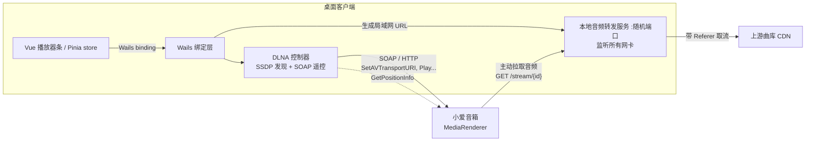

> 本文记录一个桌面应用音乐模块接入 DLNA 的完整过程：从协议认知、架构设计，到 Go 侧 SSDP / SOAP 实现、局域网音频转发改造、Wails 绑定与 Vue 前端接入，以及一路踩过的坑。
>
> 最终效果：在播放器条点一下投屏按钮，自动发现家里的小爱音箱，一键推送当前曲目；播放、暂停、音量、进度都从桌面遥控；切歌自动跟过去，本地音频自动暂停，不会两边同时出声。

---

## 一、先搞清楚：DLNA 到底是怎么"投"的

很多人第一次做投屏会直觉地以为"我的程序把音频流推给音箱"。DLNA 里恰好相反：

> **音箱主动来拉一个 URL，你的程序只负责发控制指令。**

这一条认知是整个实现的分水岭。它决定了两件事：

1. 你必须给音箱一个**它能访问到的网络地址**，而不是程序自己能访问的 `127.0.0.1`；
2. 你不需要实现推流和转码，只需要一个能返回音频字节的 HTTP 端点。

涉及的三个角色：

| 角色 | 协议中的名字 | 本文中的对应 |
| --- | --- | --- |
| 控制点 | Control Point | 桌面客户端（Vue 前端 + Go 后端） |
| 渲染设备 | MediaRenderer | 小爱音箱 |
| 待播放内容 | Media URL | 本机音频转发端点 `/stream/{trackID}` |

两个关键服务：

- **AVTransport**：负责"播什么"和播放状态——推送地址、播放/暂停/停止、跳转进度、读状态；
- **RenderingControl**：负责渲染参数——主要是音量。

### 动手前要确认的前提

- 小爱音箱 App 中打开「DLNA 音乐播放」开关（小米 AI 音箱、小爱音箱、Pro、Art、HD 等型号支持）；
- 音箱和电脑在同一局域网，路由器没开 AP 隔离；
- Windows 防火墙允许该应用通过（SSDP 响应的 UDP 入站 + 音频端点的 TCP 入站），首次运行会弹窗，别手滑点"取消"。

---

## 二、整体架构：控制链路与音频链路分离



两条链路各管各的：

- **控制链路**：前端 → Wails 绑定 → DLNA 控制器 → SOAP → 音箱，只发指令、读状态，数据量极小；
- **音频链路**：音箱 → 本机音频转发服务 → 上游曲库 CDN，客户端不推流、不转码。

这样切分的好处是：上游地址的防盗链处理、签名时效、凭证解密全都留在 Go 侧，既不越过 Wails 绑定边界，也不需要音箱理解任何鉴权逻辑。

---

## 三、第一步：SSDP 自动发现音箱

DLNA 设备发现走 SSDP（简单服务发现协议），本质是往组播地址发一条 UDP 请求：

```text
M-SEARCH * HTTP/1.1
HOST: 239.255.255.250:1900
MAN: "ssdp:discover"
MX: 1
ST: urn:schemas-upnp-org:device:MediaRenderer:1
```

`ST` 指定只找音频渲染器。线上设备回应的 `LOCATION` 指向它的描述 XML，里面能拿到设备名、UDN 和控制地址。

实现时几个细节值得单独说：

**1. 逐网卡发送，而不是只发一次。** 电脑上经常同时有 Wi-Fi、网线、Hyper-V / WSL 虚拟网卡。如果让系统随便选出口，M-SEARCH 可能从没有音箱的那张网卡发出去，自然收不到回复。所以枚举所有 `UP` 且非回环的 IPv4 地址，每张网卡绑定一个 UDP socket 分别发。

**2. 连发两次。** 家用路由器偶尔丢 UDP 包，两次发送间隔 200ms，成本极低但成功率高不少。

**3. 只认能投屏的设备。** 描述 XML 里带 `AVTransport` 服务的才算渲染器——媒体服务器（MediaServer）也会响应类似的搜索，但它不能播音频。

**4. 相对地址要拼成绝对地址。** 设备描述里的 `controlURL` 经常是 `/upnp/control/AVTransport` 这样的相对路径，用 `URLBase`（没有就用 `LOCATION`）做基准解析：

```go
u, _ := url.Parse(ref)
resolved := base.ResolveReference(u) // 相对 → 绝对
```

整个发现过程控制在 3 秒内（App 绑定层再套一层 4 秒的 context 超时），结果按设备名排序后返回前端。

---

## 四、第二步：让音箱拿得到音频（最关键的一个坑）

原来的转发服务是这样启动的：

```go
listener, err := net.Listen("tcp", "127.0.0.1:0")
```

这对浏览器里的 `<audio>` 没问题，但对音箱是灾难——推给音箱的地址会变成 `http://127.0.0.1:xxxxx/stream/...`，在音箱眼里 `127.0.0.1` 是它自己。

改造分三步：

**1. 监听所有网卡。** 端点改为 `net.Listen("tcp", ":0")`，随机端口不变。

**2. 前端地址保持原样。** `BaseURL()` 仍然返回 `http://127.0.0.1:PORT`，前端零改动，本地播放行为完全不受影响。

**3. 新增面向音箱的 `LANBaseURL(remoteHost)`。** 难点是选哪个本机 IP：直接取"第一张网卡"经常翻车，因为虚拟网卡可能排在前面。这里用了一个小技巧：

```go
// UDP connect 不真正发包，只让内核按路由表算出访问目标时应使用的源 IP。
conn, err := net.Dial("udp4", net.JoinHostPort(remoteHost, "1900"))
if err == nil {
    defer conn.Close()
    if addr, ok := conn.LocalAddr().(*net.UDPAddr); ok && addr.IP.To4() != nil {
        return addr.IP.To4().String()
    }
}
```

拿不到时再退化为枚举网卡，优先挑 `192.168.*` / `10.*` / `172.16~31.*` 私网地址。端口拼接统一用 `net.JoinHostPort`，别自己拼字符串。

转发端点本身还有两个原有设计正好派上用场：

- **每次请求都重新解析上游播放地址**，天然绕开上游 URL 的时效性；
- **透传 `Range` 请求头**，所以音箱和浏览器一样可以拖拽进度。

> 提醒：改成监听所有网卡后，等于在本机开了一个局域网可访问的端口。首次运行请确认 Windows 防火墙允许"专用网络"入站，否则设备发现得了、音频却拉不动。

---

## 五、第三步：SOAP 遥控与会话状态

控制指令是标准的 UPnP SOAP 调用，例如播放：

```http
POST /upnp/control/AVTransport HTTP/1.1
SOAPACTION: "urn:schemas-upnp-org:service:AVTransport:1#Play"
Content-Type: text/xml; charset="utf-8"

<?xml version="1.0" encoding="utf-8"?>
<s:Envelope xmlns:s="http://schemas.xmlsoap.org/soap/envelope/">
  <s:Body>
    <u:Play xmlns:u="urn:schemas-upnp-org:service:AVTransport:1">
      <InstanceID>0</InstanceID>
      <Speed>1</Speed>
    </u:Play>
  </s:Body>
</s:Envelope>
```

封装好的动作：

| 服务 | 动作 | 说明 |
| --- | --- | --- |
| AVTransport | `SetAVTransportURI` | 推送音频地址，投屏的核心一步 |
| AVTransport | `Play` / `Pause` / `Stop` | 播放控制 |
| AVTransport | `Seek` | `Unit=REL_TIME`，时间格式 `HH:MM:SS` |
| AVTransport | `GetTransportInfo` / `GetPositionInfo` | 读播放状态和进度 |
| RenderingControl | `SetVolume` / `GetVolume` | `Channel=Master`，0–100 |

几个实现要点：

- 参数按 key 排序后再拼 XML，行为可预测、方便断言；URL 里的 `&` 等字符用 `xml.EscapeText` 转义；
- 设备返回 SOAP Fault 时，提取 `faultstring` 转成简短中文提示，**原始 XML 不抛给前端**；
- `RelTime` 解析要宽容：小爱音箱可能返回 `00:01:23`，有些设备返回 `1:05`，未开始播放时甚至返回空串（按 0 处理）。

**踩坑记录：** 最初用 `DecodeElement` 解析 SOAP 响应，结果 `<u:GetVolumeResponse>` 这个包装节点会把子元素 `<CurrentVolume>` 的文本一起消费掉，最终 map 里的结果被空值覆盖。改成用 `Token()` 逐 token 遍历 + 元素名栈，只收集叶子节点的 `CharData` 才解决。

### 会话管理

`Renderer` 持有最近一次搜索到的设备列表和当前投屏会话。因为 Wails 绑定可能被连续触发（切歌、拖音量），所有状态读写都放在 mutex 下，但**网络调用不持锁**——否则一台慢设备就能卡住所有状态读取。

`Status()` 每次从设备补读播放状态和进度；读取失败时回退到本地记录。这样音箱短暂失联时界面不会突然"消失"，只是进度不更新。

---

## 六、第四步：Wails 绑定层

Go 侧暴露 7 个绑定方法：

| 方法 | 用途 |
| --- | --- |
| `MusicDLNADevices()` | SSDP 搜索设备，结果缓存在 Renderer 中 |
| `MusicDLNACast(deviceID, trackID)` | 生成局域网 URL 并推送播放 |
| `MusicDLNAControl(action)` | `play` / `pause` / `stop` |
| `MusicDLNASetVolume(volume)` | 设置音箱音量 |
| `MusicDLNASeek(seconds)` | 跳转进度 |
| `MusicDLNAStatus()` | 读取当前投屏状态 |
| `MusicDLNADisconnect()` | 停止播放并结束会话 |

绑定层做了几件"脏活"：

- 结构体字段统一 `snake_case`，与生成的 TypeScript 绑定对齐；
- 领域错误映射成稳定的 `reason` 码（`no_devices` / `not_casting` / `device_not_found` / `unavailable` …），前端据此决定提示文案或降级动作；
- 音频地址、曲库凭证等敏感信息不越过绑定边界；`Cast` 前只做凭证有效性校验；
- 设备列表可能过期（音箱重启后 UDN 变化），按 ID 找不到时自动重搜一次。

改完导出方法后重新生成绑定：

```bash
wails generate module
```

**踩坑记录：** 生成的代码里有个函数叫 `MusicDLNAStatus`，而前端自定义类型也叫 `MusicDLNAStatus`，同名冲突导致类型检查失败。解决方式是在 `backend.ts` 里给导入的函数加别名：

```ts
import { MusicDLNAStatus as GoMusicDLNAStatus } from 'wailsjs/go/app/App'
```

---

## 七、第五步：前端播放器接入

投屏状态收进 Pinia 的 `musicPlayer` store，用一个 `dlnaCasting` 标志做分支，避免本地播放和音箱播放两套逻辑互相打架：

- `togglePlay()`：投屏中走 SOAP 控制，否则操作 `<audio>`；
- `seek()`：投屏中下发 `MusicDLNASeek`，否则改 `audio.currentTime`；
- `setVolume()`：投屏时音量属于音箱，只更新本地显示并做 **250ms 防抖**后下发，避免拖动滑块时每个 `input` 事件都发一次 SOAP；
- `play()`：投屏中切歌只把新曲目推给音箱，然后 `pause()` 本地音频，**不恢复本地播放**；推送失败则退出投屏状态，自然回落到本地播放；
- `stopCast()`：先 `Disconnect`，再恢复本地播放。

播放器条上挂了一个 4 秒定时器调用 `syncDLNAStatus()`，同步音箱上报的进度、状态和音量；未投屏时 store 内部直接返回，没有额外开销；组件卸载时清理定时器。

UI 侧补了一枚投屏按钮（投屏中高亮）、一个设备选择弹窗（搜索按钮 / 设备列表 / 投屏播放 / 断开投屏），以及一行前置条件提示：打开 App 里的 DLNA 开关、连同一个 Wi-Fi、检查防火墙。

---

## 八、没有真机怎么测

手边没有音箱，也能把大部分逻辑测掉。用 `httptest` 造一个假设备：

- `/desc.xml` 返回带 `AVTransport` 和 `RenderingControl` 两个服务的设备描述；
- `/control` 根据 `SOAPACTION` 记录动作名，并返回对应的 `GetVolumeResponse` / `GetPositionInfoResponse`。

然后断言：

- 发现流程能解析出设备名、UDN 和控制地址；
- 投屏时推过去的 URL 正是预期的局域网地址；
- 动作序列是 `SetAVTransportURI → Play → GetVolume`；
- SOAP Fault、相对地址解析、`RelTime` 解析等纯函数各有独立用例。

最终验证：

```bash
go test ./...                       # Go 全量单测
cd frontend && npm run typecheck    # vue-tsc
npm run build                       # vite 生产构建
```

三项全部通过。真机联调只需要验证网络侧（防火墙、同网段）和音质表现。

---

## 九、给使用者的三步说明

1. 在小爱音箱 App 里打开「DLNA 音乐播放」，确认音箱和电脑连的是同一个 Wi-Fi；
2. 在应用播放器里随便点一首歌，点播放器条的投屏按钮 →「搜索设备」→ 选中音箱 →「投屏播放」；
3. 投屏成功后本地自动静默，进度条和音量直接遥控音箱；点「断开投屏」即可回到本地播放。

搜不到设备时，按这个顺序排查：App 开关 → 是否同一网段 / AP 隔离 → Windows 防火墙 → 音箱重启后再搜一次。

---

## 十、踩坑速查表

| 现象 | 根因 | 解决 |
| --- | --- | --- |
| 搜不到任何设备 | App 未开 DLNA 开关、AP 隔离、组播被拦 | 按第九节顺序排查 |
| 能搜到设备但播放失败 | 推给音箱的是 `127.0.0.1` | 用 `LANBaseURL()` 生成局域网地址 |
| 多网卡环境下地址不对 | 取了虚拟网卡的 IP | UDP 路由探测选出口 IP |
| 音量读出来是空 | SOAP 包装节点覆盖了结果字段 | 用 Token 栈只收集叶子节点 |
| 前端类型检查报同名冲突 | 生成的函数与自定义类型同名 | import 时加别名 |
| 投屏后进度条不走 | 本地 `<audio>` 的 `timeupdate` 与音箱无关 | 定时同步设备上报的进度 |
| 拖音量时音箱卡顿 | 每个 input 事件都发一次 SOAP | 250ms 防抖 |

---

## 十一、写在最后

这次实现里最值得复用的经验有四条：

1. **先搞清楚数据流向再动手。** "谁拉谁"搞反了，后面写再多代码都是白费；
2. **控制面和数据面分开。** SOAP 指令和音频流走两条链路，任何一边出问题都不会拖垮另一边；
3. **给外部设备的地址要从路由表推导。** 遍历网卡"猜"出来的 IP，在多网卡环境下几乎必错；
4. **边界层输出 reason 码而不是底层异常。** 前端拿到稳定的枚举值，既能友好提示，也能做自动降级。

整个功能没有引入任何第三方 UPnP 库，只用 Go 标准库实现了 SSDP 和 SOAP；硬件不在身边时，靠协议替身也能把逻辑验证得七七八八。希望这份记录对你接入其他 DLNA 设备（不只是小爱音箱）有帮助。

---

*说明：本文按通用技术视角记录实现过程，未包含具体项目的仓库路径与版本标识。*
