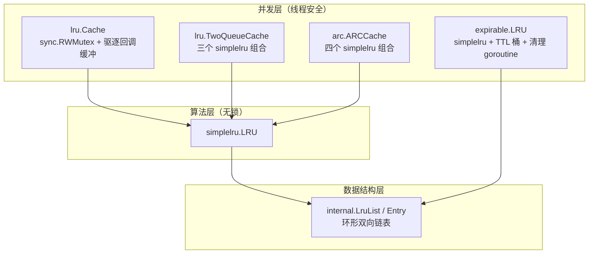

> 基于仓库 `hashicorp/golang-lru`（v2 主分支，commit `235099c`）源码分析。
> 数据截至 2026-10：5.1k+ Stars / 540+ Forks / 被 93,000+ 仓库依赖，MPL-2.0 许可证。

## 一、它是什么

`golang-lru` 是 HashiCorp 开源的 Go 语言 LRU 缓存库，源自 Brad Fitzpatrick 的 groupcache 中的 LRU 实现。它表面上看只是"一个哈希表加一个双向链表"，但被 Consul、Nomad、Vault 以及 GitHub 上九万多个仓库依赖，成为 Go 生态事实意义上的标准 LRU 实现。

它提供了**四种**缓存：

| 缓存 | 包 | 算法 | 特点 |
|---|---|---|---|
| `lru.Cache` | 主模块 | 标准 LRU | 简单、够用、开销最低 |
| `lru.TwoQueueCache` | 主模块 | 2Q | 抗突发扫描，约 2x 开销 |
| `arc.ARCCache` | **独立模块** `arc/v2` | ARC | 自适应免调参，IBM 专利 |
| `expirable.LRU` | 主模块 | LRU + TTL | 支持过期时间 |

一个看似简单的库，把这四种变体都实现了，而且代码总量不过三千行——这本身就值得拆开看看。

## 二、仓库结构：三层加一个例外

```
golang-lru/
├── lru.go                  # 线程安全的简单 LRU（Cache）
├── 2q.go                   # 2Q 缓存（TwoQueueCache）
├── doc.go                  # 包级文档，讲清三种算法的取舍
├── simplelru/
│   └── lru.go              # 非线程安全的核心 LRU 算法
├── internal/
│   └── list.go             # 内部双向链表（container/list 风格）
├── expirable/
│   └── expirable_lru.go    # 带 TTL 的 LRU
└── arc/                    # ⚠️ 独立 go module（arc/v2）
    ├── arc.go
    └── go.mod              # require github.com/hashicorp/golang-lru/v2 v2.0.7
```

注意一个细节：`arc` 是**独立的 Go module**，而不是主模块的子包。README 和 `doc.go` 都解释了原因：

> ARC has been patented by IBM, so do not use it if that is problematic for your program. For this reason, it is in a separate go module contained within this repository.

也就是说，引入主模块的用户**不会**被动引入 ARC 代码，彻底规避专利顾虑。这是一个很克制、很专业的工程决策。

## 三、核心设计剖析

### 3.1 经典数据结构：map + 环形双向链表

LRU 的经典解法是"哈希表 + 双向链表"：哈希表 O(1) 定位，链表维护使用顺序。这个库的链表实现在 `internal/list.go`，基本是从 Go 标准库 `container/list` 改造而来：

```go
type Entry[K comparable, V any] struct {
	next, prev *Entry[K, V]   // 双向链表指针
	list       *LruList[K, V] // 所属链表
	Key        K
	Value      V

	ExpiresAt    time.Time // 过期时间（expirable 用）
	ExpireBucket uint8     // 所在过期桶（expirable 用）
}

// 为简化实现，链表被构造成环：&l.root 既是尾节点的 next，也是头节点的 prev
```

两个关键设计：

1. **哨兵节点（sentinel）**：`root` 是值嵌入在 `LruList` 里的哨兵，空表时 `root.next == root.prev == &root`，插入删除永远不用判空。
2. **Entry 里存 `ExpiresAt`/`ExpireBucket`**：内部链表从一开始就为 expirable 变体预留了字段，主 LRU 完全不受影响。这是"为扩展而设计"的典型手法。

`simplelru.LRU` 则是算法核心，全部操作 O(1)：

```go
type LRU[K comparable, V any] struct {
	size      int
	evictList *internal.LruList[K, V]
	items     map[K]*internal.Entry[K, V]
	onEvict   EvictCallback[K, V]
}

func (c *LRU[K, V]) Add(key K, value V) (evicted bool) {
	if ent, ok := c.items[key]; ok {   // 已存在：更新并移到头部
		c.evictList.MoveToFront(ent)
		ent.Value = value
		return false
	}
	ent := c.evictList.PushFront(key, value) // 新键：插入头部
	c.items[key] = ent
	if evict := c.evictList.Length() > c.size; evict {
		c.removeOldest()                    // 超容：淘汰尾部
	}
	return evict
}
```

### 3.2 分层架构：算法与并发分离

整个库分为三层，职责边界非常清晰：



这个分层带来三个直接好处：

- **算法可独立测试**：`simplelru` 不含任何锁，单测可以专注验证淘汰逻辑；
- **高级算法复用基座**：2Q 和 ARC 都是"几个 LRU 拼装 + 调度策略"，不用重复实现链表；
- **并发策略可替换**：想换分锁（sharding）或锁无关结构，只需要动最上层。

### 3.3 线程安全：一个容易看漏的细节

`lru.Cache` 对外暴露的 API 分两类锁：

- `Get` 用 **写锁**（`c.lock.Lock()`）：因为命中后要 `MoveToFront` 修改链表结构，不是纯读操作；
- `Contains` / `Peek` / `Keys` / `Values` / `Len` 用**读锁**：只读 map 或链表，不动结构。

`ContainsOrAdd` / `PeekOrAdd` 这类"检查后添加"的复合操作，则必须在**同一把写锁**内完成，避免竞态。这些选择都对，但如果你自己照着抄一个，很容易在 `Get` 上误用 RLock。

### 3.4 回调设计：锁外执行 + 驱逐缓冲（全库最精彩的部分）

`onEvict` 回调用于资源清理（比如关闭文件句柄、减引用计数）。初看实现会觉得有点绕：

```go
func (c *Cache[K, V]) initEvictBuffers() {
	c.evictedKeys = make([]K, 0, DefaultEvictedBufferSize) // 16
	c.evictedVals = make([]V, 0, DefaultEvictedBufferSize)
}

// 简单lru 触发驱逐时，只往缓冲区追加，不直接调用户回调
func (c *Cache[K, V]) onEvicted(k K, v V) {
	c.evictedKeys = append(c.evictedKeys, k)
	c.evictedVals = append(c.evictedVals, v)
}

func (c *Cache[K, V]) Add(key K, value V) (evicted bool) {
	c.lock.Lock()
	evicted = c.lru.Add(key, value)
	if c.onEvictedCB != nil && evicted {
		k, v = c.evictedKeys[0], c.evictedVals[0]
		c.evictedKeys, c.evictedVals = c.evictedKeys[:0], c.evictedVals[:0]
	}
	c.lock.Unlock()
	if c.onEvictedCB != nil && evicted {
		c.onEvictedCB(k, v)   // 锁外调用
	}
	return
}
```

为什么不在锁里直接回调？两个原因：

1. **防死锁 / 允许重入**：用户回调里完全可以再调用 `cache.Get(...)`。如果持锁调用，写锁不可重入，直接死锁。`expirable` 包的文档把这个保证写得明明白白，还专门有 `TestOnEvictReentrant` 测试。
2. **缩短临界区**：用户回调可能很慢（IO、加锁），不应阻塞其他 goroutine 的缓存操作。

代价是缓冲区大小有上限：`Add`/`Remove`/`RemoveOldest` 每次最多驱逐 1 个，取 `[0]` 即可；`Purge`/`Resize` 可能一次驱逐多个，改用动态 slice 全量取出。`evictedKeys[:0]` 复用底层数组，避免反复分配。

## 四、四种缓存逐一分析

### 4.1 标准 LRU（lru.Cache）

最朴素的一层封装，API 却相当完整：`Add` / `Get` / `Peek` / `Contains` / `ContainsOrAdd` / `PeekOrAdd` / `Remove` / `RemoveOldest` / `GetOldest` / `Keys` / `Values` / `Len` / `Cap` / `Resize` / `Purge`。

两个少见于同类库但很有用的 API：

- `ContainsOrAdd`：检查 key 是否存在（不更新热度），不存在则添加——适合"只加载一次"的场景；
- `Resize`：运行时动态调整容量，自动淘汰溢出的条目并触发回调。

### 4.2 2Q：对抗"缓存污染"

标准 LRU 的软肋是**批量扫描**：一次性遍历大量 key（如全表扫描、爬虫任务）会把热数据全部挤出缓存。2Q（Two Queue）把缓存拆成两个队列：

```go
type TwoQueueCache[K comparable, V any] struct {
	recent      simplelru.LRUCache[K, V]        // 最近访问（只被访问过一次）
	frequent    simplelru.LRUCache[K, V]        // 频繁访问
	recentEvict simplelru.LRUCache[K, struct{}] // ghost：只存 key 不存 value
	...
}
```

流程：

1. 新 key 进入 `recent`；
2. `recent` 中的 key 再次被访问 → **提升**到 `frequent`；
3. `recent` 溢出时，淘汰的 key 记入 ghost 队列 `recentEvict`（只存 key，省内存）；
4. 一个刚被淘汰的 key 很快又来了（在 ghost 中命中）→ 直接进 `frequent`，说明它是真热数据。

这样扫描型冷数据最多污染 1/4 的缓存（默认 `recentRatio=0.25`），热数据躲在 `frequent` 里安然无恙。代价是约 2x 的计算开销和一点元数据。

### 4.3 ARC：免调参的自适应方案

ARC（Adaptive Replacement Cache）更进一步，维护 T1（最近）/ T2（频繁）两个数据队列和 B1 / B2 两个 ghost 队列，核心是一个动态参数 `p`：

```go
// B1 命中 → 说明该多给 T1 空间，p 增大（δ 与 B2/B1 长度比相关）
// B2 命中 → 说明该多给 T2 空间，p 减小
func (c *ARCCache[K, V]) replace(b2ContainsKey bool) {
	t1Len := c.t1.Len()
	if t1Len > 0 && (t1Len > c.p || (t1Len == c.p && b2ContainsKey)) {
		c.t1.RemoveOldest()  // 淘汰进 B1
	} else {
		c.t2.RemoveOldest()  // 淘汰进 B2
	}
}
```

`p` 根据两类 ghost 的命中反馈自动伸缩，无需像 2Q 那样手工设 `recentRatio`/`ghostRatio`。但 **ARC 被 IBM 持有专利**，所以它住在独立 module `github.com/hashicorp/golang-lru/arc/v2` 里，主模块用户完全不感知。

### 4.4 expirable：分时桶实现的 TTL

`expirable.LRU` 在 LRU 之上加过期时间，设计上最有巧思的是**分时桶（bucket）清理**：

```go
const numBuckets = 100 // uint8 索引，上限 256

// 后台 goroutine 每 ttl/100 触发一次 deleteExpired，
// 每次只清理 oldest bucket，且会等桶内最新条目过期后再删
func (c *LRU[K, V]) deleteExpired() {
	bucketIdx := c.nextCleanupBucket
	timeToExpire := time.Until(c.buckets[bucketIdx].newestEntry)
	if timeToExpire > 0 { /* 解锁睡眠等待 */ }
	for _, ent := range c.buckets[bucketIdx].entries {
		c.removeElement(ent, &evicted)
	}
	c.nextCleanupBucket = (c.nextCleanupBucket + 1) % numBuckets
}
```

把 TTL 时间轴切成 100 个桶，新条目插入时计算落入哪个桶，清理时每次只处理一个桶。这样清理开销被均摊到整个 TTL 周期，不会出现"整表同时过期导致某一次清理卡顿"的毛刺。同时 `Get`/`Peek`/`Keys`/`Values` 都带惰性过期检查，保证已过期但未清理的条目不会被读到。

其他工程细节：

- `size = 0` 表示**无限容量**（关闭 LRU 机制，纯 TTL 缓存）；
- `ttl = 0` 表示不过期（内部转为 10 年的 `noEvictionTTL`，且不启动清理 goroutine）；
- `Close()` 停掉清理 goroutine，`Restart()` 可重启——长连接/测试场景很有用；
- 回调同样在锁外触发，且明确支持重入。

## 五、代码质量与文化

- **测试**：每个算法都有 `Test*_RandomOps` 随机模糊测试 + 边界用例 + 并发测试 + 基准测试（`BenchmarkLRU_Rand` / `Benchmark2Q_Freq` 等），基准覆盖随机访问和频率访问两种负载；
- **泛型**：v2 全面转向 `Cache[K comparable, V any]`，key 不再局限于 `interface{}`，省去装箱开销；
- **文档**：`doc.go` 一页纸讲清三种算法的开销对比和专利提示，README 给最小可运行示例；
- **规范**：`golangci.yml` + `.copywrite.hcl` 统一版权头（`Copyright IBM Corp. 2014, 2025`），`.go-version` 管理工具链版本；
- **兼容**：主模块 `go 1.19`，ARC 模块 `go 1.18`，对老项目友好。

## 六、选型建议

| 场景 | 推荐 |
|---|---|
| 通用本地缓存、API 结果缓存 | `lru.New` |
| 存在顺序扫描 / 批量遍历，怕污染热数据 | `lru.New2Q` |
| 访问模式未知、不想调参、无专利顾虑 | `arc.NewARC` |
| 需要 TTL 过期（token、配置、限流计数） | `expirable.NewLRU` |
| 驱逐时要释放资源 | 任一 + `NewWithEvict` 回调 |

最小示例：

```go
import "github.com/hashicorp/golang-lru/v2"

func main() {
	// 128 容量的线程安全 LRU
	l, _ := lru.New[int, any](128)
	for i := 0; i < 256; i++ {
		l.Add(i, nil) // 自动淘汰最旧的
	}
	fmt.Println(l.Len()) // 128
}
```

## 七、总结

`golang-lru` 值得学习的地方，不在于链表怎么写——而在于它展示了一个基础库该如何做取舍：

1. **算法与并发分离**：`internal` → `simplelru` → 并发层，各层可独立测试、独立演进；
2. **回调锁外执行 + 缓冲**：用一点复杂度换取"用户回调可安全重入"的确定性和更短的临界区；
3. **专利风险用 module 边界隔离**：ARC 单独成 module，需要的人显式引入，不需要的人零成本；
4. **为扩展预留结构**：内部 Entry 提前带上过期字段，expirable 变体无需改动核心；
5. **文档即设计**：doc.go 把开销、专利、适用场景说清楚，减少使用者的决策成本。

如果你在自己的项目里手写过 LRU，不妨对照一下：淘汰是否 O(1)？`Get` 是否误用了读锁？回调会不会死锁？这个小库就是这几个问题的标准答案。

---

**参考**

- 仓库：<https://github.com/hashicorp/golang-lru>
- 文档：<https://pkg.go.dev/github.com/hashicorp/golang-lru/v2>
- 原始实现：<https://github.com/golang/groupcache/tree/master/lru>
